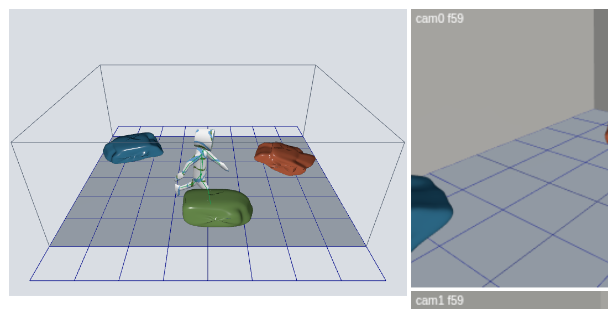
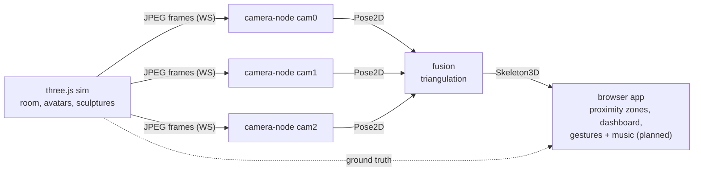

# posesim

A simulation testbed for an interactive art installation. Resin-cast wavy sculptures stand in a virtual room. Three virtual cameras watch the people moving among them. A CPU-only pipeline estimates each person's 3D pose, and that will drive stereo music from a shared conductor.





The sim is built to be swapped for real cameras later: a calibration file (OpenCV model) and a `FrameSource` interface sit between the cameras and the pipeline.

## Status

Work in progress. Slice by slice, see [SLICES.md](SLICES.md):

| Slice | State |
|---|---|
| V1 one avatar, 3 views, 3D skeleton | Pipeline works end to end. Targets not yet met: offline median MPJPE ~106 mm (target 80), live ~3–5 FPS per node on one laptop (target 10). Blocked on a human-like avatar. |
| V3 sculptures and proximity zones | Done, zone events come from the *estimated* skeleton. Sound is not built yet. |
| V2 multi-person, V4 gestures, V5–V6 music, V7 lens distortion, V8 CI gate | Planned |

Branches: `v1` is PR #5 and `v3` is stacked on it (PR #6).

## Quick start

Needs Python 3.11+ with [uv](https://docs.astral.sh/uv/), and Node 24.

```bash
make setup           # frozen Python + Node dependencies
make dev             # sim app only (Vite)
uv run python scripts/run_scenario.py --duration 20
```

The scenario script starts 3 camera nodes, fusion and the Vite server, drives a headless Chromium, checks the V1 targets and writes `runs/<timestamp>/report.json` and `room.png`. The first run downloads about 40 MB of RTMPose/YOLOX ONNX weights. It exits non-zero while a target is missed, which is the case today.

## Usage

```bash
# Keep the received frames, then re-run detection offline with L/R diagnostics
uv run python scripts/run_scenario.py --dump-frames
uv run python scripts/analyze_run.py runs/<timestamp>

# One service by hand (ports come from config/room.json)
uv run camera-node --camera cam0 --calibration calibration/cam0.json --port 9001
uv run fusion --nodes ws://127.0.0.1:9001/poses ws://127.0.0.1:9002/poses ws://127.0.0.1:9003/poses --port 9100
```

Geometry, camera poses, thresholds and sculpture seeds live in `config/` (`room.json`, `objects.json`). Regenerate calibration with `uv run python scripts/make_calibration.py`.

## Docs

- [PLAN.md](PLAN.md), [SLICES.md](SLICES.md), [QUESTIONS.md](QUESTIONS.md) and the [ADRs](docs/adr/): what and why.
- [docs/avatar-handoff.md](docs/avatar-handoff.md): swapping in a human-like avatar (needs Blender).
- [ASSETS.md](ASSETS.md): licence ledger for every asset and model.

## Contributing

Run `make hooks` once per clone, then `make check` before pushing. Branch per slice, PR only. Conventions are in [CLAUDE.md](CLAUDE.md). Questions and bugs go in GitHub issues.

## License

Apache-2.0, see [LICENSE](LICENSE). The pose model weights' training-data terms have not been audited, see [ASSETS.md](ASSETS.md).
